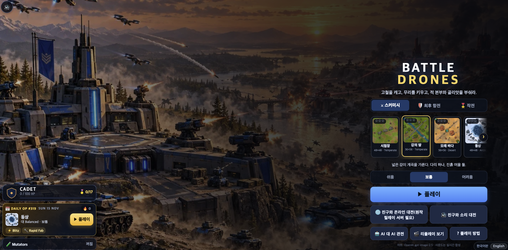
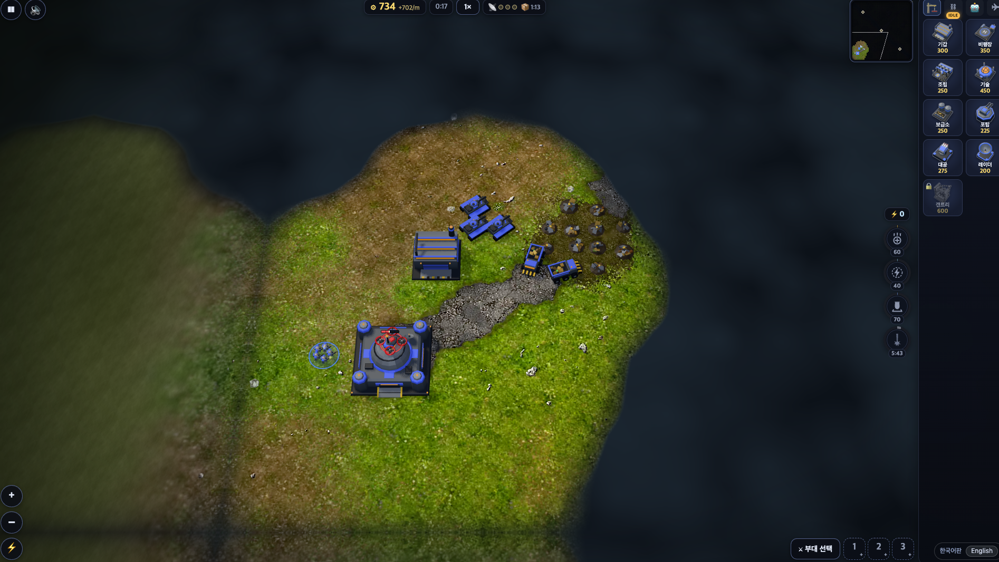

<div align="center">

# 배틀 드론 한국어판 (Battle Drones KO)

**비공식 한국어판 — 모바일 웹 RTS 「Battle Drones」의 화면 문구를 한국어로**

[▶ 플레이하기](https://sigco3111.github.io/battledrones-ko/) · [원작 저장소](https://github.com/simonw/battledrones) · [원작 데모](https://simonw.github.io/battledrones/)

</div>

설치도, 계정도, 다운로드도 없습니다. 링크를 열면 브라우저 탭 안에서 바로 게임이 시작됩니다.

---

## 게임 소개

「Battle Drones」는 simonw가 만든 **모바일 웹 실시간 전략(RTS)** 게임입니다. `Command & Conquer` 계열에서 영감을 받았고, 하늘을 나는 드론과 지상 로봇 부대로 고철을 캐고, 기지를 세우고, 적 본부를 부수는 것이 목표입니다.

- **자원**: 고철(기본)과 크리스탈(고가). 수확기가 자원을 캐서 본부·보급소·고정된 골리앗으로 운반합니다. 파괴된 유닛은 1분 동안 값의 30%짜리 잔해를 남깁니다.
- **승리 조건**: 적 본부와 적의 모든 골리앗을 파괴하면 이깁니다. 반대로 골리앗이 하나라도 서 있는 한, 본부를 잃어도 바로 패배하지 않습니다.
- **오프너**: 모든 스커미시는 첫 선택으로 시작합니다 — ⚡ 전격전(기갑 공장 + 스팅어 3), 🔧 산업(기갑 공장 + 수확기 추가 + 고철 200), ✈ 비행단(비행장 + 와스프 3). 적도 함께 고릅니다.
- **지휘관 능력**: 오른쪽 ⚡ 게이지를 써서 집중포격(포탄 3발), EMP(4초 동결), 강하 포드(보이는 곳에 3유닛 낙하)를 호출합니다. 6:00부터는 양측 모두 스카이 해머(2.5분마다 궤도 타격)를 쓸 수 있습니다. 타격 전에는 항상 경고 원이 먼저 표시됩니다.
- **업링크와 보급**: 📡 업링크는 맵 중앙의 쟁탈 지점입니다. 점령하면 초당 1.5 고철, 주변 시야, ⚡ 게이지 충전을 얻습니다(항공기는 절반, 수확기는 불가. 양측이 함께 있으면 멈춥니다). 📦 보급 상자는 1:30부터 75초마다 두 개씩 떨어지고, 먼저 닿는 쪽이 가져갑니다.
- **부대**: 소총병·로켓·저격 분대, 와스프·랩터·호넷, 박격포·마스토돈·랜서, 콘도르 수송기, 그리고 갠트리에서 건조하는 이동식 기지 **골리앗**.
- **모드**: ⚔ 스커미시, 🛡 최후 항전(끝없는 웨이브 방어), 🎖 작전(수제 임무 캠페인), 📅 데일리 작전(모두에게 같은 하루 한 판), 🧪 변형 규칙, 그리고 10계급 경력(훈련병 → 원수)과 17개 훈장.
- **맵**: 시험장·강의 땅·모래 바다·동상·잿더미 땅·나침반(4인용)·군도, 그리고 시드를 공유하는 무작위 맵.
- **관전·리플레이**: 🤖 AI 대 AI 관전(시네마틱 카메라, C), 🎬 리플레이 보기.
- **표현**: 아트는 원작 제작 파이프라인(OpenAI gpt-image-2.5)으로 생성했고, 사운드는 실행 중에 합성합니다.

## 실행 화면

[배포본](https://sigco3111.github.io/battledrones-ko/)에서 캡처한 실제 실행 화면입니다.

| 메인 메뉴 | 스커미시 |
|:-:|:-:|
|  |  |
| 스커미시·최후 항전·작전 탭과 한글 맵 카드(시험장·강의 땅·모래 바다·동상), 난이도 선택이 보이는 메인 메뉴입니다. | 인게임 화면. 생산 메뉴(기갑·비행장·보급소·포탑·겐트리 등)와 지휘관 능력 버튼이 한국어로 표시됩니다. |

## 한국어판 특징

- **화면 문구 번역 사전 625항목 + 정규식 규칙 28개** — 메뉴·모드·맵 이름과 설명, 난이도, 오프너 카드, 인게임 HUD(자원·업링크·지휘 게이지·생산 버튼·지원 호출), 유닛 16종과 건물 이름·역할, 전투 알림·토스트, 승패·무승부 화면, 경력 등급, 플레이 방법의 소제목까지.
- **한국어/English 실시간 전환**: 오른쪽 아래 표시 바의 버튼으로 언제든 원문과 오갈 수 있고, 선택은 브라우저(localStorage)에 저장됩니다.
- **한글 표시 최적화**: Apple SD Gothic Neo · Malgun Gothic · Noto Sans KR 순의 시스템 글꼴을 우선 적용하고, 웹폰트는 내려받지 않습니다. `<html lang="ko">`.
- **원작 보존**: 게임 로직·밸런스·에셋은 손대지 않고 화면에 보이는 문구만 바꿉니다. 원문은 노드별로 보관해 두었다가 English 모드에서 그대로 되돌립니다.
- **용어 고정**: [docs/glossary.md](docs/glossary.md)에 원문 → 한국어 표기를 정리해 두었습니다(고철, 크리스탈, 본부, 골리앗, 업링크, 지원 호출 등).

### 번역 범위

- 메인 메뉴, 모드 탭, 맵 카드와 지형 설명, 난이도, 변형 규칙
- 오프너 선택 카드와 설명, 인게임 HUD·생산 패널·지휘관 능력
- 전투 알림과 토스트(본부 피격, 골리앗 견인, 생산 불가 등), 일시정지·설정
- 승패·무승부·작전 결과 화면의 지표 이름, 리플레이·관전 버튼
- 플레이 방법 패널의 **소제목**(목표, 오프너, 지휘관 능력, 목표물, 경제, 건설, 부대, 보병, 콘도르, 골리앗, 상성, 지형, 카메라, 속도)

### 남은 부분

- 플레이 방법 패널의 **본문 문단**은 아직 영어입니다. 소제목과 핵심 용어만 번역했습니다.
- 온라인 대전 로비 문구 일부, 리플레이 뷰어, 원작 개발 문서(`*.md`)는 번역하지 않았습니다.
- 맵 카드의 일부 짧은 표기(`Temperate`, `4 Players`, `Random` 등)와 "3 Stingers" 같은 수치+명사 조합은 원문이 남아 있습니다.

## 번역 방식

원작은 TypeScript에 문자열을 하드코딩하고 HUD를 DOM으로 그립니다. 그래서 소스를 문장마다 고치는 대신 **표시 시점 번역 오버레이**를 씁니다.

- `src/i18n/overlay.ts` — DOM 텍스트 노드와 `title`/`aria-label`/`placeholder`/`alt` 속성, `<title>`을 관찰해 사전에 있는 문구만 한국어로 바꿉니다. 원문은 `WeakMap`에 노드별로 보존하고, English로 바꾸면 그대로 복원합니다.
  - `MutationObserver`로 나중에 그려지는 UI와 다시 그려지는 화면도 따라가고, 400 ms마다 한 번 더 훑어 갱신을 놓치지 않습니다.
  - `SCRIPT`/`STYLE`/`CANVAS` 등은 건드리지 않고, 오버레이 자신의 표시 바도 제외합니다.
- `src/i18n/ko/*.json` — 7개 파일로 나눈 사전. `s`는 원문 → 한국어 고정 표기(총 625항목), `r`은 숫자·고유명사가 섞인 동적 문구용 정규식 규칙(총 28개)입니다.
- `index.html` — 오버레이 스크립트 한 줄만 추가했습니다.
- 용어는 [docs/glossary.md](docs/glossary.md)에 고정했습니다.

## 조작

| 동작 | 방법 |
| --- | --- |
| 화면 이동·확대 | 드래그로 이동, 두 손가락으로 확대·축소, 미니맵 탭으로 이동 |
| 유닛 선택 | 탭 / 길게 눌러 드래그(박스 선택) / 두 번 탭(화면의 같은 종류 전부) |
| 선택에 추가·제외(마우스) | Shift + 클릭 |
| 이동·공격 | 지면 탭 = 공격 이동, 적 탭 = 공격 |
| 분대 1·2·3 | 칩을 길게 눌러 저장, 탭으로 선택, 두 번 탭으로 카메라 이동 · 키보드 1–3 선택, Ctrl(또는 Shift)+1–3 저장 |
| 건설 | 기지 탭 → 구조물 선택 → 지도에 위치 지정(드래그 가능) → ✓ 배치 · 마우스는 지점 클릭 |
| 콘도르 | 분대를 선택하고 콘도르를 탭해 탑재 → 지도 길게 눌러 이동·하역 (하역 키 U) |
| 골리앗 | ⚓ 고정(땅에 박기) · ⇡ 접기(다시 걷기) — 키 G |
| 속도 | 시계 옆 1× 칩으로 1.5×·2×, 시계를 길게 누르면 3× |
| 시네마틱 카메라 | C (AI 대 AI 관전) |
| 일시정지·설정 | ❚❚ 버튼 |

## 로컬 실행

```bash
npm install
npm run dev            # http://localhost:5173/
```

배포본과 같은 하위 경로(`/battledrones-ko/`)로 빌드하려면:

```bash
npx vite build --base=/battledrones-ko/
npx vite preview --base=/battledrones-ko/
```

테스트는 `npm test`(vitest + 페이지 아카이브 검사)입니다. GitHub Actions `ko-build` 워크플로를 수동 실행하면 같은 명령으로 빌드해 GitHub Pages에 올리고, 빌드 산출물에 루트 절대 경로가 남았는지 검사합니다.

## 크레딧

- **원작**: **Battle Drones** — 제작 **simonw** · <https://github.com/simonw/battledrones>
- **원작 라이선스**: **Apache License 2.0** — 원작 `LICENSE` 원문을 수정 없이 그대로 두었고, `NOTICE`에 변경 사실을 적었습니다.
- **한국어판**: 번역·표시 시점 오버레이·빌드 **sigco3111** · <https://github.com/sigco3111/battledrones-ko>
- **사용 라이브러리**(원작 및 빌드 그대로): three.js 0.185 (MIT), qrcode-generator (MIT), Vite (MIT), vite-plugin-pwa (MIT), vite-node (MIT), Vitest (MIT), TypeScript (Apache-2.0), Playwright (Apache-2.0).
- **아트·사운드**: 아트는 원작 제작 파이프라인(OpenAI gpt-image-2.5)으로 생성되었고, 사운드는 실행 중에 합성됩니다. 게임 안 오른쪽 아래에 이 표기가 함께 나옵니다.

## 라이선스·원작 표기

- 원작 코드 라이선스 **Apache-2.0**을 따릅니다. 원작 `LICENSE`(Apache License 2.0 전문)를 수정 없이 그대로 두었고, 이 저장소가 가한 변경 사항은 `NOTICE`에 적었습니다(원작에는 별도 NOTICE 파일이 없습니다).
- 이 저장소가 추가한 부분(`src/i18n/`, `docs/glossary.md`, `tools/wrapup/`)도 같은 라이선스 조건으로 배포합니다.
- 원작자와 무관한 **비공식 2차 창작**입니다. 원작자·권리자의 요청이 있으면 **즉시 비공개 전환 및 삭제**합니다. 이슈(<https://github.com/sigco3111/battledrones-ko/issues>)나 저장소 프로필로 알려 주세요.

## 한계 — 온라인 대전

원작은 친구와의 온라인 대전에 자체 WebSocket 릴레이(wss://battledrones-relay.fly.dev)를 씁니다. 이 한국어판은 그 서버를 쓰지 않도록 코드를 고치지 않았지만, **번역 오버레이 때문에 배포본의 버전 해시가 원작과 달라 실제 대전은 성립하지 않습니다.** 메뉴의 🌐 친구와 온라인 대전, 🔊 친구와 소리 대전 항목은 남아 있지만 연결되지 않습니다. AI 대전, 최후 항전, 작전, 데일리 작전, 관전, 리플레이는 모두 정상 동작합니다.

## [번역 외 변경]

- `index.html`: `lang="ko"`, 오버레이 스크립트 1줄, 변경 고지 주석 추가.
- `src/i18n/`(오버레이 + 사전), `docs/glossary.md`, `NOTICE`, `tools/ko_scan2.py`(번역 대상 문자열 스캔), `tools/wrapup/screenshots.mjs`(배포 화면 캡처용) 추가.
- 원작의 `.github/workflows`는 가져오지 않고, 배포용 `ko-build` 워크플로만 두었습니다.
- 원작 게임 로직·밸런스·에셋은 변경하지 않았습니다.

## 검증 기록

| 항목 | 결과 |
| --- | --- |
| Pages 주소 | 확인 (메뉴 렌더) |
| 한국어 표시 | 확인 (메뉴·맵 목록·난이도·오프너·HUD·생산 버튼·일시정지·플레이 방법 소제목) |
| English 전환 | 확인 (원문 복귀, 선택 저장) |
| 하위 경로 배포 | 확인 (base=/battledrones-ko/) |
| 실제 플레이 | 부분 확인 (스커미시 시작·오프너·HUD·일시정지·도움말까지) |
